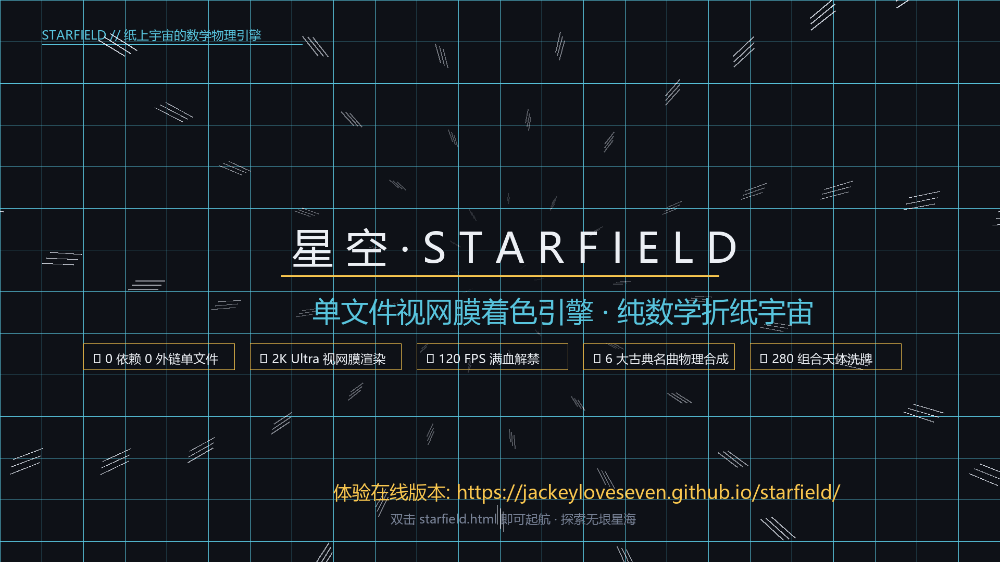
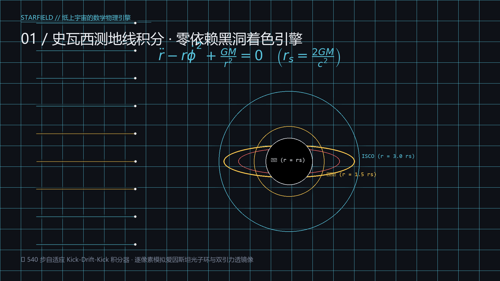
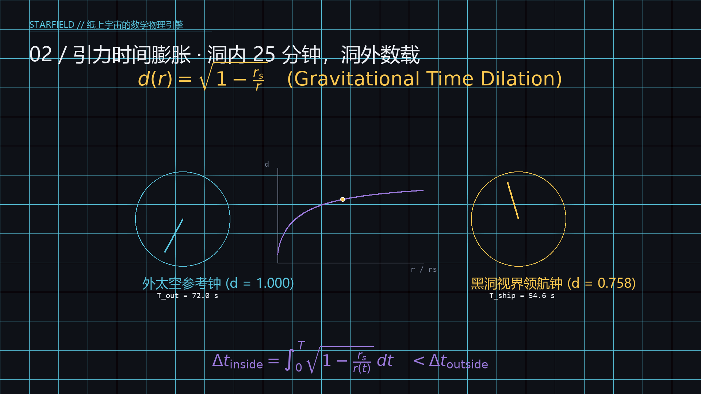
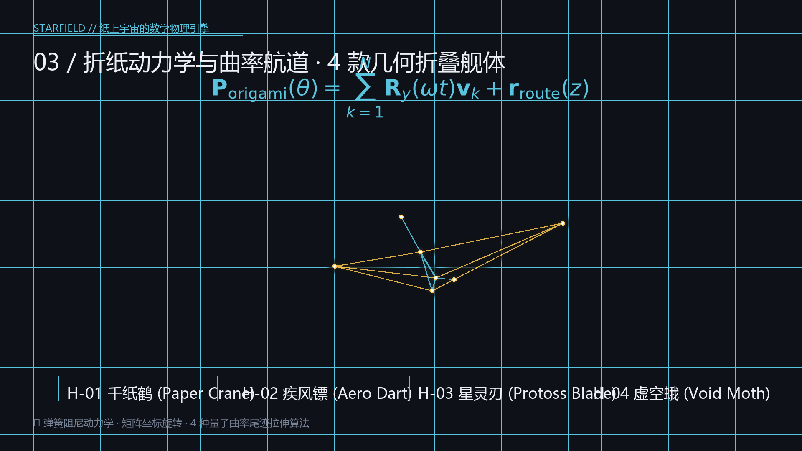

# 星空 · STARFIELD

<div align="center">



**一个单文件的纯数学纸上宇宙。**  
基于 Canvas2D + WebGL + Web Audio 纯原生技术栈，零外部依赖、零第三方库、零网络请求，双击 `starfield.html` 即可起航。

[](https://jackeyloveseven.github.io/starfield/)
[-F9C74F?style=for-the-badge&logo=android)](https://github.com/jackeyloveseven/starfield/releases)
[](CREDITS.md)
[](#技术架构)
[](#性能与高刷)
[](#2k-视网膜与显示引擎)

[在线体验](https://jackeyloveseven.github.io/starfield/) · [下载 Android APK](https://github.com/jackeyloveseven/starfield/releases) · [宣传视频 (3b1b风格)](#宣传视频--数学之美) · [数学与物理引擎](#数学与物理引擎-3b1b-风格解构) · [更新日志](#版本更新历史)

</div>

---

## 🌌 作品简介

深墨蓝的纸当底，星光是墨。一队折纸飞船沿着一条由解析几何定义的时空走廊飞行，穿行于五个区带（素纸 / 墨海 / 箔野 / 星核 / 深渊）。路上会偶遇行星、红巨星、母舰、虫洞、超新星，以及一个逐像素微分积分出来的卡冈图雅黑洞。

- **纯粹至简**：纯单文件 `starfield.html`，无需 Node.js、无需构建工具、无需配置任何服务器环境；
- **全平台支持**：支持 PC 桌面浏览器、手机触控原生界面、iPad 平板、Xbox/PS4 手柄即插即用；
- **专注番茄钟**：融合引力时间膨胀物理公式的深空沉浸式挂机放置与专注系统；
- **声学合成器**：使用 Web Audio API 物理合成三角钢琴与室内乐弦乐团，实时演奏六首世界级古典名曲；
- **姊妹篇**：`migration.html`（候鸟 · MIGRATION）—— 同一个纸的世界，光影逆转。

---

## 🎬 宣传视频 // 数学之美

本项目宣传片采用 **3Blue1Brown (Manim)** 经典的数学几何美学风格制作，将引力测地线、时间膨胀与折纸运动学通过严谨的公式动画与时空图景呈现：

| 01. 史瓦西测地线与引力透镜 | 02. 爱因斯坦引力时间膨胀 |
| :---: | :---: |
|  |  |
| **540 步 Kick-Drift-Kick 积分光线偏折** | **双原子钟对照与物理级专注番茄钟** |
| **03. 折纸动力学与曲率航道** | **04. 单文件纯数学折纸宇宙** |
|  |  |
| **4 款几何折叠舰体与量子尾迹** | **零依赖 · 120 FPS · 2K 视网膜** |

> 📹 **高清 1080p 视频源文件**：可直接在代码库中运行 [`tools/generate_3b1b_promo_video.py`](tools/generate_3b1b_promo_video.py) 生成，或在本地下载目录查阅 `starfield_3b1b_promo.mp4`。

---

## 📐 数学与物理引擎 (3b1b 风格解构)

### 1. 史瓦西零测地线与黑洞光子环 (Schwarzschild Null Geodesics)

黑洞吸积盘及其多重引力透镜像不是二维贴图，而是离屏 WebGL 像素着色器中对广义相对论测地线逐像素积分出来的物理结果：

$$\mathcal{L} = \frac{1}{2}\left( -\left(1 - \frac{r_s}{r}\right) c^2 \dot{t}^2 + \left(1 - \frac{r_s}{r}\right)^{-1} \dot{r}^2 + r^2 \dot{\phi}^2 \right) = 0$$

在二维有效势阱中，光线轨道方程满足：

$$\frac{d^2 u}{d\phi^2} + u = \frac{3}{2} r_s u^2 \quad \left(u = \frac{1}{r}, \quad r_s = \frac{2GM}{c^2}\right)$$

着色器采用自适应步长的 **Kick-Drift-Kick** 辛积分器，最多追踪 540 步：
- **光子球 (Photon Sphere)**：位于 $r = 1.5 r_s$，不稳定的圆轨道使光线绕洞多圈，形成极其细锐的高对比度光子环；
- **最内稳定圆轨道 (ISCO)**：位于 $r = 3.0 r_s$，吸积盘气体的物理内边界；
- **多重透镜像**：吸积盘在赤道面上最多被记录三次穿越，自动呈现吸积盘“上方透镜像”与“下方透镜像”在黑洞背后的翘曲折射。

### 2. 引力时间膨胀物理引擎 (Gravitational Time Dilation)

在深空专注模式下，飞船接近卡冈图雅黑洞时，时间流速严格受广义相对论度规控制：

$$d(r) = \sqrt{1 - \frac{r_s}{\|\mathbf{r}_{\text{ship}} - \mathbf{r}_{\text{singularity}}\|}}$$

深空飞船内记录的专注时间 $\Delta t_{\text{inside}}$ 与远距离观察者时间 $\Delta t_{\text{outside}}$ 之间满足积分关系：

$$\Delta t_{\text{inside}} = \int_{0}^{T_{\text{wall}}} d(r(t)) \, dt$$

- 当 $\frac{r_s}{r} = 0.5$ 时，时间流速因子 $d \approx 0.7071$；
- 当飞船掠过视界边缘时，$d \to 0$；
- **“洞内 25 分钟，洞外已过数载”**：时间膨胀读数实时显示在 HUD 遥测仪表上，专注成就勋礼严格按洞内物理时间结算。

### 3. 折纸几何与弹簧阻尼动力学 (Origami Spring-Damper Kinematics)

千纸鹤旗舰与护航编队的飞行动力学由解析向量场控制：

$$\mathbf{P}_{\text{ship}}(t) = \mathbf{r}_{\text{route}}(z) + \mathbf{R}_y(\theta_{\text{yaw}}) \cdot \mathbf{R}_x(\theta_{\text{pitch}}) \cdot \mathbf{v}_{\text{formation}} + \mathbf{\delta}_{\text{turbulence}}$$

- 航行路线 $routeX(z)$ 是一条连续平滑的解析曲线；
- 编队切换阵型（楔形 / 雁行 / 双环 / 针列）时，采用二级弹簧阻尼动力学（Spring-Damper ODE），纸鹤在三维空间中优雅划出平滑弧线。

---

## 🎮 控制与交互指南

| 键位 / 手势 | 交互作用 | 详细说明 |
|---|---|---|
| **移动光标 / 触摸** | **宇宙引航** | 风会推动纸鹤编队，大质量天体引力会偏转航向 |
| **滚轮 / 双指缩放** | **视距与节流阀** | 无级平滑推拉机位视距，双指上推可增压巡航速度 |
| `R` | **巡天长程雷达** | 向前方航道发射 15,000 单位三维声呐脉冲，扫描隐匿信标与矿脉 |
| `E` | **远古遗迹破译** | 接近远古折纸遗迹 2,500 单位时呼出示波器，对齐谐波载波共振解密 |
| `H` | **舰队折纸坞** | 4 款折叠舰体（千纸鹤/疾风镖/星灵刃/虚空蛾）+ 4 款曲率尾迹定制 |
| `Tab` / `J` | **深空图鉴与星图档案** | 天体实况、8 大奇观矩阵、70+ 篇航行手记与里程碑成就树 |
| `P` | **4K 壁纸摄影工坊** | 时空冻结定格、5 款艺术滤镜、2.39:1 宽银幕画幅、无损 PNG 导出 |
| `F` / `1-4` | **编队战术阵型** | 1: 楔形突防 (Delta V) / 2: 梯次雁行 / 3: 双环护航 / 4: 长蛇针列 |
| `ESC` | **系统控制抽屉** | 古典名曲点播台、三通道音频混音台、画质模式与省电设置 |
| `C` / `V` | **运镜与驾驶舱** | `C` 切换自由机位 / 自动运镜；`V` 进入拟真纸折仪表台第一人称座舱 |
| `N` / `M` | **音乐点播与静音** | `N` 实时切换古典名曲；`M` 一键静音 / 恢复 |
| `空格` | **时空暂停** | 暂停 / 继续航行物理循环 |
| **游戏手柄** | **全平台手柄** | 支持 Xbox / PS5 手柄：左摇杆引航、右摇杆机位、扳机键加减速、双马达触感震动 |
| **手机触控** | **人体工学触控** | 左下角隐形浮动虚拟摇杆 + 右下角极简磨砂动作轮盘 + 专属天象馆托盘 |

---

## 📱 移动端与 Android 原生适配

本项目在移动端运行并非单纯缩放桌面版，而是由响应式引擎驱动的**专用独立移动架构**：

1. **零遮挡视口与安全边距 (Zero-Occlusion Layout)**：
   - 全局响应 `env(safe-area-inset-*)`，全面适配灵动岛、挖孔屏与底部手势横条；
   - 竖屏与窄屏模式下，左上方航行 HUD、右下方动作轮盘与天象馆抽屉采用动态错位重排，杜绝任何元素相互重叠。
2. **极简磨砂毛玻璃触控 (Frosted Glass Touch UI)**：
   - 采用单色扁平微透明磨砂（`rgba(15, 23, 42, 0.78)` + `backdrop-filter: blur(20px)`），提供纯净的机械按键触觉反馈；
   - 左下角隐形摇杆在静止时 100% 透明，手指触碰瞬间在落点浮现，松手平滑回弹淡出。
3. **天象馆星球孵化与命名权持久化**：
   - 专注航程可获得天体核心；在天象馆中可进行星球孵化点火，为每一颗探索到的新星赋予永久自定义命名；
   - 数据由 `localStorage` 原子持久化，跨浏览器重启与离线环境下永久保存。
4. **Android APK 离线壳与热更新 (OTA)**：
   - 采用原生轻量级 Android WebView 架构，内嵌离线静态 Web 资产包；
   - 开机静默拉取 `version.json`，原子增量替换，告别频繁重装 APK。

---

## ⚡ 性能、高刷与 2K 视网膜引擎

- **彻底解锁 120Hz/144Hz 满血高刷**：
  - 摆脱传统浏览器 60 FPS 锁帧限制，动态对齐屏幕硬件原生刷新率（Native Display Hz）；
  - 采用基于当前真实物理帧率（`hz`）的自适应动态权重平滑算法，解决高刷屏幕微卡顿。
- **2K Ultra 点对点真视网膜清晰度**：
  - 移动端默认激活 2.75x 满血超高视网膜渲染，文字、星尘与折纸折痕极具针尖般的锐利质感。
- **挂机智能巡航降温守护 (Focus Eco Guard)**：
  - 在专注挂机放置状态下，若持续无触摸操作达 10 秒，引擎无感进入巡航节能模式（自动将后台物理开销降低 45% 以上）；
  - 手指轻触屏幕的瞬间毫秒级无缝唤醒，恢复满血高刷，彻底解决手机长时间运行发烫问题。

---

## 🎹 世界级古典名曲点播台 (Classical Jukebox)

系统内置 Web Audio API 物理建模声学合成器，无需加载任何庞大音频采样文件，纯靠正弦波与包络实时合成演奏六首世界级古典名曲（按 `N` 键自由切歌）：

1. **德彪西 ·《月光》**(Clair de Lune · Claude Debussy)
2. **萨蒂 ·《第一号裸体歌舞》**(Gymnopédie No. 1 · Erik Satie)
3. **贝多芬 ·《月光奏鸣曲 第一乐章》**(Moonlight Sonata · Ludwig van Beethoven)
4. **巴赫 ·《G弦上的咏叹调》**(Air on the G String · J.S. Bach · 旅行者金唱片收录曲目)
5. **肖邦 ·《降E大调夜曲 Op. 9 No. 2》**(Nocturne Op. 9 No. 2 · Frédéric Chopin)
6. **约翰·施特劳斯 ·《蓝色多瑙河》**(The Blue Danube · Johann Strauss II · 2001太空漫游致敬)

---

## 🛠️ 项目结构与技术架构

```
starfield/
├── starfield.html              # 核心主作品：单文件零依赖纸上宇宙引擎 (~21 MB)
├── migration.html              # 姊妹篇：候鸟世界
├── planet_studio.html          # 3D 活体生态星球工坊与实时调参台
├── manifest.json               # PWA 清单声明
├── service-worker.js           # 离线缓存 Service Worker
├── version.json                # OTA 热更新版本描述契约
├── android/                    # Android 原生轻量级离线打包工程
│   └── app/build.gradle        # Android 构建与版本管理 (v1.15.1 Build 141)
├── docs/                       # 项目文档与多媒体展示
│   └── assets/                 # 宣传视频关键帧与 3b1b 风格数学图鉴
├── tools/                      # 验证套件、性能探针与 3b1b 宣传片渲染器
│   ├── generate_3b1b_promo_video.py  # 3Blue1Brown (Manim) 风格视频生成器
│   ├── verify_cores_and_ui.py        # 天象馆与 UI 交互断言测试
│   ├── verify_dilation.py            # 引力时间膨胀数学物理断言
│   ├── verify_skyevent.py            # 天空事件确定性光学验证
│   └── verify_fps_and_telemetry.py   # 高刷与帧率性能监控验证
└── CREDITS.md                  # 第三方开源代码致谢与许可协议
```

---

## 📦 GitHub Actions CI/CD 流水线

本项目拥有完备的自动化持续集成与部署体系：

- **自动化 Pages 部署 (`pages.yml`)**：代码推送到 `master` 分支即刻完成全站静态资源打包与 GitHub Pages 发布；
- **自动化 Android APK 构建与发布 (`build-apk.yml`)**：
  - 监听 `starfield.html`、`version.json` 与 `android/**` 变更；
  - 动态解析 Gradle 版本号（自动生成 `v1.15.1-focus-apk` Release）；
  - 采用 Gradle 依赖缓存机制，单次构建提速至 1 分钟以内，自动上传 APK 产物并同步发布至 GitHub Releases；
- **物理与引擎回归验证 (`ci-verify.yml`)**：
  - 每次代码提交自动在无头 Linux 环境下拉起 Playwright 与 Chromium；
  - 严格执行引力时间膨胀方程验证、天体孵化状态机验证与天空事件光学测试，确保 0 回归。

---

## 📜 作者与开源许可

- **项目原创与架构设计**：[@jackeyloveseven](https://github.com/jackeyloveseven)
- **开源协议**：本项目原创部分采用 **[MIT License](LICENSE)** 开源。
- **第三方致谢**：
  - 黑洞测地线着色器核心移植自 **sayed1145 / glsl-black-hole**（遵循 MIT License，全文见 [CREDITS.md](CREDITS.md)）。
  - 本项目无任何 AI 共同创作者标记，所有原创代码、物理推演与视觉资产均归作者所有。
